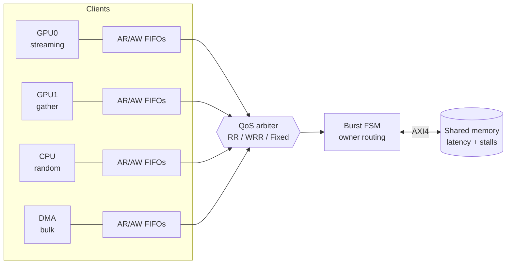
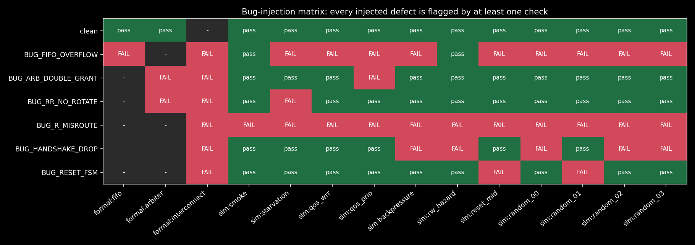
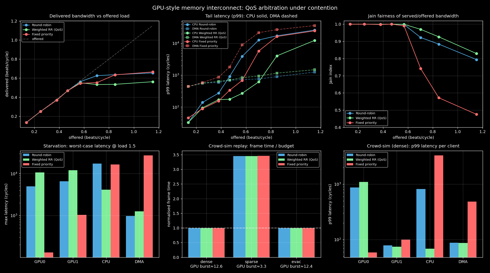

# GPU-Style Memory Interconnect with Formal Verification & QoS Scheduling

**SystemVerilog · C++ · Python · AXI4 · Verilator · SymbiYosys**

A simplified SoC memory subsystem in which GPU compute engines, a CPU core and a DMA engine compete for one shared memory port through a parameterized AXI4 interconnect. The project does more than show that the fabric works. It also shows **how it fails, how each defect is isolated, and how the verification stack catches regressions**. Real workloads come from an instrumented **crowd-simulation engine** whose memory traces are replayed through the RTL.




## Highlights

| Area | What's implemented |
|---|---|
| **Interconnect** | N-client AXI4 fabric (AR/R/AW/W/B), INCR bursts up to 256 beats, byte strobes, per-client request queues, ID tagging, full ready/valid backpressure |
| **QoS arbitration** | Runtime-selectable **round-robin**, **weighted round-robin** (credit based, programmable weights) and **fixed priority** |
| **Traffic** | Python generator for GPU sequential streams, CPU random accesses and DMA bulk copies; a C++ **crowd-sim** trace source with GPU warp-style coalescing |
| **Formal** | SymbiYosys: **unbounded k-induction proofs** for the FIFO and the arbiter, plus BMC of the full fabric (AXI handshake rules, single-owner routing, reset recovery) and cover checks for reachability |
| **Dynamic** | Verilator + C++ scoreboard: data integrity, in-order IDs, RLAST, stray responses, deadlock watchdog, starvation bound; tests for backpressure, read/write hazards and reset during traffic, plus seeded random runs |
| **Performance** | Contention sweep: throughput, p99 and worst-case latency, Jain fairness, crowd-sim frame time |
| **Regression** | Bug-injection matrix: 6 realistic RTL bugs, each re-injected and caught automatically |

## Quick start

```bash
brew install verilator sby yices2     # or: oss-cad-suite
pip install matplotlib

make test       # simulation regression (directed + random)
make formal     # FIFO/arbiter proofs, fabric BMC, cover
make bughunt    # inject every bug, show which check catches it
make perf       # contention sweep + crowd replay -> docs/img/
```

Run a single trace by hand, optionally dumping a waveform:

```bash
make sim
python3 traffic/gen_traffic.py -o /tmp/t.trace --load 1.2
./build/sim/Vmem_subsystem_top --trace /tmp/t.trace --policy wrr --stall --bp 0.3 --vcd /tmp/wave.vcd
```

## Repository layout

```
rtl/        sync_fifo, qos_arbiter, axi_interconnect, axi_mem, mem_subsystem_top
formal/     fifo.sby, arbiter.sby, interconnect.sby   (clean + per-bug tasks)
tb/         sim_main.cpp - Verilator testbench, AXI client agents, scoreboard
traffic/    gen_traffic.py - GPU / CPU / DMA / hazard / hog traffic profiles
crowd/      crowd_sim.cpp - crowd engine -> coalesced AXI burst traces
scripts/    run_tests.py, bug_hunt.py, perf_sweep.py
docs/       generated bug matrix, perf summary, plots
```

## Formal verification

| Block | Mode | Properties |
|---|---|---|
| `sync_fifo` | **prove** (k-induction) | `count <= DEPTH`; flags consistent; **FIFO ordering + data integrity** (an arbitrary tagged element leaves after exactly the entries ahead of it, unmodified) |
| `qos_arbiter` | **prove** (k-induction) | `$onehot0(grant)` (**no duplicate grants**); grant only goes to requesters; work conserving; **round-robin bounded wait**: a requester is skipped at most N−1 times, via the inductive invariant `wait + dist(ptr,i) ≤ N−1` |
| `axi_interconnect` | BMC (depth 16) + cover | VALID held until READY with a stable payload on AR/AW/W/R/B; one-hot `s_rvalid`/`s_wready`/`s_bvalid`; never AR and AW together; clean idle after reset; all sub-block properties |

The environment is constrained with AXI *assumptions* on the clients and the memory, and covers show that complete read and write bursts are reachable. Without them, the proofs could pass vacuously.

## Failure analysis: bug-injection matrix

Each bug is a realistic RTL mistake behind a `` `define `` (`make sim BUG=BUG_R_MISROUTE`). `make bughunt` rebuilds the design with every bug and runs the whole verification stack against it:



| Bug | Symptom | First caught by |
|---|---|---|
| `BUG_FIFO_OVERFLOW` | queue accepts a push while full, so commands are duplicated | formal `count <= DEPTH`; sim `ORDER: GPU1 got RID 5, expected 1` |
| `BUG_ARB_DOUBLE_GRANT` | `req & ~(req<<1)` grants several clients and a request is lost | formal `$onehot0(grant)`; **only one** sim test (`qos_prio`) |
| `BUG_RR_NO_ROTATE` | RR pointer never advances, so the arbiter behaves like fixed priority | formal bounded-wait invariant; sim `STARVATION: DMA waited 70286 cycles` |
| `BUG_R_MISROUTE` | R beats routed by the live arbiter output instead of the latched owner | formal R-VALID stability; sim `RLAST: GPU1 beat 8/15` |
| `BUG_HANDSHAKE_DROP` | ARVALID drops before ARREADY | formal AXI VALID-hold; sim **only under memory stalls** (deadlock watchdog) |
| `BUG_RESET_FSM` | FSM state survives reset, leaving stale bursts after reset | formal reset-recovery assertion; sim **only** `reset_mid` |

The table shows why both methods are needed. Several bugs slip past most simulation tests: a double grant only appears in priority mode, a dropped handshake only when memory stalls, and a stale FSM only on reset mid-burst. Formal catches every one of them within a few cycles and produces a counterexample VCD (`formal/<job>/engine_0/trace.vcd`). The full report with diagnostics is in [docs/bug_matrix.md](docs/bug_matrix.md).

## Performance verification



Results at offered load 1.5 (over saturation); see [docs/perf_summary.md](docs/perf_summary.md):

| Policy | Throughput (beats/cycle) | CPU p99 (cycles) | DMA worst case (cycles) | Jain fairness |
|---|---|---|---|---|
| Round-robin | 0.636 | 17 286 | 977 | 0.88 |
| Weighted RR (2,2,8,2) | 0.535 | **4 064** | 1 263 | **0.93** |
| Fixed priority | 0.634 | 16 458 | **27 067** (starved) | 0.57 |

Takeaways:
- **Round-robin is fair in grants, not in bandwidth.** A CPU making 1-beat requests gets the same number of grants as a GPU making 16-beat bursts, so its latency explodes under load.
- **Weighted RR protects the latency-sensitive client.** CPU p99 drops about 4 times with no starvation. The cost is about 15% raw throughput, because more grants go to short bursts that amortize less of the memory latency.
- **Fixed priority starves the low-priority clients.** Fairness collapses to 0.57 and DMA waits more than 27k cycles.

## Crowd-simulation traces

`crowd/crowd_sim.cpp` is a small agent-based crowd engine (spatial-hash neighbour search, separation and goal steering). Each kernel is mapped onto an SoC client, and the per-lane addresses are **coalesced per 32-lane warp** into AXI bursts, the same way a GPU memory coalescer works, so memory locality shows up directly as burst length:

| Kernel | Client | Access pattern |
|---|---|---|
| integrate (pos/vel update) | GPU0 | streaming structure-of-arrays |
| neighbour gather | GPU1 | depends on the spatial ordering of agents |
| grid rebuild | CPU | scattered read-modify-write |
| frame export | DMA | 32-beat bulk copies |

| Scenario | GPU gather burst | Fabric throughput | Frame time vs budget |
|---|---|---|---|
| `dense` (agents sorted by cell) | 12.6 beats | 0.48 | **1.0×** |
| `evac` (exit rush, export every frame) | 12.4 beats | 0.61 | 1.0× |
| `sparse` (unsorted, scattered) | 3.3 beats | 0.27 | **3.5× overrun** |

The same simulation with a cache-unfriendly data layout moves the same work at 2.2 times lower efficiency and misses its frame budget by 3.5 times, without any change to the hardware. This links software data layout directly to interconnect behaviour. Any engine can drive the fabric by emitting the same trace format: `<cycle> <client> <R|W> <addr> <axi_len>`.

## Design notes and limitations

- Single memory port, one burst in flight at a time. This keeps ordering trivially correct and the formal model small. Outstanding-transaction pipelining would be the next step.
- Clients get disjoint 16 KB address regions so the scoreboard can predict data exactly. Contention is about bandwidth, not address sharing.
- The full fabric is checked with bounded model checking (depth 16); the FIFO and arbiter have unbounded proofs.
